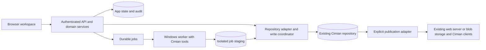

# Architecture exploration

Status: proposed boundaries, not an implemented system · 2026-10-20

## Shape

A modular application, a durable job runner, and a repository adapter. The
browser never receives filesystem or cloud storage credentials. A Windows worker
runs only the operations the application host cannot perform.

Many Cimian repos are served from Azure Blob Storage, S3, or a web server that
syncs from Git. Editing a directory clients read directly is **live on save**; the
UI must say so. Prefer an authoring checkout and a publication step that pushes a
complete revision.

## Repository layout

A Cimian repo uses `pkgsinfo/`, `manifests/`, `catalogs/`, `pkgs/`, and `icons/`.
All metadata is YAML. Catalogs are generated from pkginfo by `makecatalogs`.
Manifests reference items by `name`, include other manifests, and carry
`conditional_items` in two forms: a string expression (`hostname contains 'ENG-'`)
and a `fact`/`operator`/`value` mapping.

## Domain modules

| Module             | Responsibility                                                          |
| ------------------ | ----------------------------------------------------------------------- |
| Repository         | Configured roots, capabilities, path identities, scan revisions         |
| Metadata           | YAML documents, unknown keys, source preservation, validation           |
| Packages/manifests | Editing rules, references, ordering, dependency graph                   |
| Conditions         | Parse both condition forms, show facts, report syntax errors            |
| Change sets        | Drafts, base revision, diff, validation, conflict/recovery state        |
| Jobs               | Durable lifecycle, progress, cancellation, retries, worker capabilities |
| Git/publication    | Optional commits, branch state, deployment-specific release             |
| Identity/audit     | Repository authorization and attributable operations                    |

## Backend

The backend is chosen once, in FleetMate Web Admin, by a spike that round-trips
both studios' fixtures. Cimian's input to that spike: whether its .NET YAML models
and condition parser can be split out of the `net10.0-windows` projects, or
whether an independent codec preserves comments, key order, and quoting with less
code. Either way, this repository supplies the Cimian fixture set.

## Data fidelity

- Identity is repository ID plus normalized relative path, not package `name`.
- Version strings stay strings: `"120.0"` must not become `120`.
- Preserve absent versus false, key order, list order, unknown keys, block scalars
  in scripts, and comments where the codec allows. Never silently drop a comment.
- Windows paths and environment variables (`%ProgramFiles%`) are data; the server
  never expands or normalizes them.
- A no-op edit writes nothing. A changed file gets a preview before save.
- Catalogs are generated artifacts. Use the official `makecatalogs` through the
  worker rather than reimplementing catalog semantics.

## Writes and concurrent editors

Each read returns a revision derived from original bytes; each save includes it.
Under a per-repo writer lock: re-read, compare, validate, journal, write through a
temporary file and rename, update the index, append audit. A rename makes one
replacement atomic, not a multi-file change; batches need a journal and recovery.

An application lock does not stop `cimiimport`, AutoPkg, CimianStudio, or a Git
pull. Writable deployments need a shared locking contract or an app-owned
authoring checkout. A direct live mount stays read-only until that is proven.

## Jobs and the Windows boundary

Portable work (parsing, graph validation, editing, condition parsing) runs on the
app host. Tool work runs on a Windows worker: `catalog.generate` (`makecatalogs`),
`installer.inspect` (MSI/MSIX/EXE metadata), `package.import` (`cimiimport`),
`package.build` (`cimipkg`), and `repo.clean` (`repoclean`). Probe tool versions;
do not infer capability from OS alone.

The job contract matches Munki Web Studio: job ID, repo ID, immutable input
revision, operation, validated arguments, tool requirements, idempotency key.
Workers return structured results and staged artifacts with hashes. Never execute
installer payloads or pkginfo scripts during inspection.

## Authentication and execution boundary

OIDC-backed server sessions, secure cookies, CSRF protection for mutations, and
server-side repository authorization. Proposed roles: Viewer, Editor, Publisher,
Administrator. Repo roots come from configuration, never browser paths. Enforce
path and symlink containment, bounded YAML parsing (no aliases bombs, depth and
size limits), private upload staging, and allowlisted worker executables launched
with argument arrays. A PowerShell script editor edits data; it is not a shell.

## Verification

Fixture round trips, parity with `makecatalogs` output, stale-write and crash
tests, path-escape requests, cancellation/retry tests, and a browser test of one
complete edit/review flow. Client behavior needs a disposable Cimian client.
