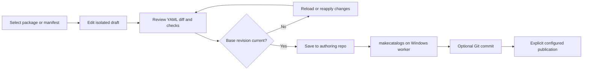

# Design direction

Status: exploratory; [workspace study](design/workspace.html) uses invented data.

## Shared workspace, Cimian content

The study starts from Munki Web Studio's accepted split-view workspace (accepted
2026-10-16): source-list sidebar, searchable object list, structured editor, and
an explicit draft review. Layout, spacing, tabs, and the review dialog match so
an admin who runs both platforms moves between them without relearning.

What changes is content and identity:

- Records are YAML pkginfo with Windows installer types: `msi`, `exe`, `msix`,
  `nupkg`, `ps1`.
- Detection shows `installs` entries (file path and version, MSI product code).
- Uninstall shows the `uninstaller` list; Advanced shows `supported_architectures`,
  `minimum_os_version`, and `blocking_applications`.
- Manifests show both `conditional_items` forms as readable rules.
- The accent is a Windows blue in place of MunkiStudio's cardboard brown; light and
  dark palettes keep the same contrast roles.

## Information architecture

| Navigation | Primary work                                     | Later expansion                  |
| ---------- | ------------------------------------------------ | -------------------------------- |
| Packages   | Filter, select version, edit pkginfo             | Imports and installer inspection |
| Manifests  | Includes, managed items, conditional items       | Effective preview for a fact set |
| Catalogs   | Membership and `makecatalogs` state              | Promotion rules                  |
| Changes    | Diff, validation, conflicts, save/commit/publish | Pull-request workflow            |
| Activity   | Job state and attributable changes               | Operational history              |
| Settings   | Repository capabilities, worker, identity        | Multiple repos and connectors    |

Do not show a sidebar of disabled future features.

## Conditions

Show each conditional block as a rule header followed by the items it adds:
"When hostname contains 'ENG-' → install vscode, git". The fact/operator/value form
renders the same way. Unknown facts and syntax errors are flagged inline with a link
to source. Editing conditions waits for a parser decision; the study is read-only.

## Edit/review journey

## States to design before writes

| State             | User-facing behavior                                              |
| ----------------- | ----------------------------------------------------------------- |
| Empty repo        | Explain required layout; offer sample data or connection settings |
| Invalid YAML      | Keep file visible; show parser line and column with source access |
| Read-only repo    | Browsing works; editing explains the restriction                  |
| Unsaved draft     | Persistent draft label and review action                          |
| External edit     | Conflict with before/after content and reapply path               |
| No Windows worker | Explain which tool is needed; no fake job launch                  |
| Missing payload   | Pkginfo visible with the missing `pkgs/` path flagged             |

## Accessibility and responsive behavior

Same targets as Munki Web Studio: semantic navigation, labeled inputs, visible
focus, keyboard-operable tabs and dialogs, text alongside status color, WCAG 2.2
AA. At narrow widths the list stacks above detail.

## Review questions

Should conditional items get their own destination or stay inside Manifests? Which
worker job matters first after catalogs: imports or installer inspection? Should
the two web studios share one deployment with a repository-type switch?
